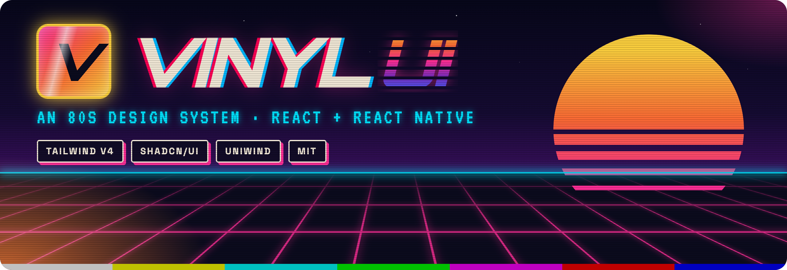
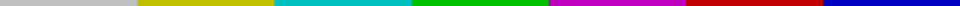
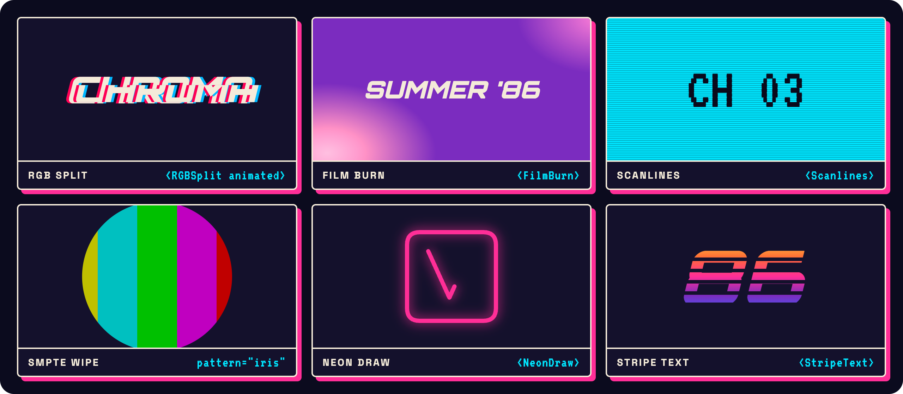
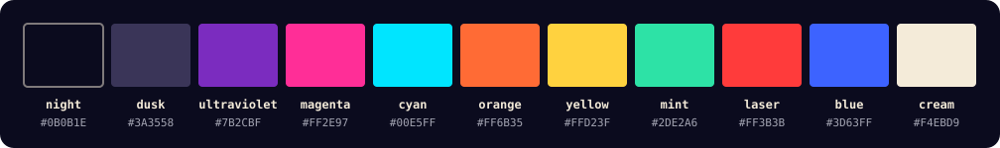

<p align="center">
  
</p>

<p align="center">
  <a href="https://github.com/supmanyu/vinyl-ui/actions/workflows/ci.yml"></a>
  <a href="LICENSE"></a>
  
  
  
</p>

<p align="center">
  <b>Neon palette · RGB splits · film burns · scanlines · SMPTE wipes · neon draw</b><br />
  An open-source design system that looks like a late-night VHS broadcast,<br />
  for <b>React</b> (Tailwind CSS v4 + shadcn/ui) and <b>React Native</b> (Uniwind + React Native Reusables).
</p>

<p align="center">
  <a href="https://vinyl-ui.pages.dev"><b>📼 Docs</b></a> ·
  <a href="#-side-a--quick-start"><b>▶ Quick start</b></a> ·
  <a href="#-side-b--effects"><b>✦ Effects</b></a> ·
  <a href="#-components"><b>▦ Components</b></a> ·
  <a href="#-palette"><b>◐ Palette</b></a>
</p>



## 📼 Tracklist

| | Track | |
| :-- | :-- | :-- |
| **A1** | [Quick start (web)](#web) | shadcn CLI, one theme, any component |
| **A2** | [Quick start (React Native)](#react-native) | Expo + Uniwind, same CLI |
| **B1** | [Effects](#-side-b--effects) | RGB split, film burn, scanlines, SMPTE wipes, neon draw, shine, stripe text |
| **B2** | [Components](#-components) | 30 shadcn/ui components restyled, plus 4 Vinyl originals |
| **B3** | [Palette](#-palette) | Night Drive & Sun-Faded themes, AA-checked |
| **Bonus** | [Liner notes](#-liner-notes) · [Packages](#-packages) · [Development](#-development) | |


## ▶ Side A · Quick start

Vinyl UI ships the shadcn way: tokens and effects are npm packages, and components are copied into
your project from a registry, so you own the code.

### Web

```jsonc
// components.json
{
  "registries": { "@vinyl": "https://vinyl-ui.pages.dev/r/web/{name}.json" }
}
```

```bash
npx shadcn@latest add @vinyl/theme @vinyl/button @vinyl/glitch-text
```

```tsx
import { Button } from '@/components/ui/button';
import { GlitchText } from '@/components/ui/glitch-text';

export default function Hero() {
  return (
    <section className="dark bg-background p-12">
      <GlitchText>Night Drive</GlitchText>
      <Button glitch>Press play</Button>
    </section>
  );
}
```

### React Native

Same CLI and same component names. Point `@vinyl` at the native registry:

```jsonc
// components.json (Expo + Uniwind project)
{
  "registries": { "@vinyl": "https://vinyl-ui.pages.dev/r/native/{name}.json" }
}
```

```bash
npx shadcn@latest add @vinyl/theme @vinyl/button @vinyl/glitch-text
```

```tsx
import { Button } from '@/components/ui/button';
import { GlitchText } from '@/components/ui/glitch-text';
import { Text } from '@/components/ui/text';

<GlitchText>Night Drive</GlitchText>
<Button><Text>Press play</Text></Button>
```

→ Full guides: [web](apps/docs/content/docs/installation/web.mdx) · [React Native](apps/docs/content/docs/installation/native.mdx)


## ✦ Side B · Effects

<p align="center">
  
</p>

One import, two implementations: CSS on the web, Reanimated + SVG on native.

```tsx
import { FilmBurn, NeonDraw, RGBSplit, Scanlines, Shine, SmpteWipe, StripeText } from '@vinyl-ui/effects';

<RGBSplit animated>CHROMA</RGBSplit>
<SmpteWipe pattern="iris" onEnd={next}><Slide /></SmpteWipe>
<StripeText>86</StripeText>
```

| Effect | Looks like | Web utility |
| :-- | :-- | :-- |
| **RGBSplit** | Chromatic aberration with optional glitch bursts | `rgb-split` `animate-glitch` |
| **FilmBurn** | Warm light leak drifting over the frame | `film-burn` |
| **Scanlines** | CRT raster lines | `scanlines` |
| **SmpteWipe** | Broadcast transitions: bars, barn doors, box, iris, diagonal, blinds | `animate-wipe-*` `wipe-out` |
| **NeonDraw** | A sign tracing itself in glowing stroke | `animate-draw` |
| **Shine** | Diagonal sheen across chrome | `animate-shine` |
| **StripeText** | Outrun slit type in the vice gradient | `text-stripes` `text-vice` |

Every animation **respects reduced motion**, and glitch bursts stay under WCAG's three-flashes-per-second limit.
Chain them into a full 80s TV opening with the [title-sequence recipe](apps/docs/content/docs/recipes/title-sequence.mdx).


## ▦ Components

Every component exists for **web** and **React Native**, with matching names and variants.

**Vinyl originals:**
`glitch-text` · `neon-tile` · `test-pattern` · `wordmark`

**shadcn/ui, restyled:** thick borders, hard retro shadows and SMPTE-wipe motion:
`accordion` · `alert` · `alert-dialog` · `aspect-ratio` · `avatar` · `badge` · `button` · `card` · `checkbox` ·
`collapsible` · `context-menu` · `dialog` · `dropdown-menu` · `hover-card` · `input` · `label` · `menubar` ·
`popover` · `progress` · `radio-group` · `select` · `separator` · `skeleton` · `switch` · `tabs` · `textarea` ·
`toggle` · `toggle-group` · `tooltip`

```bash
npx shadcn@latest add @vinyl/<name>
```


## ◐ Palette

<p align="center">
  
</p>

| Theme | Mood | Switch |
| :-- | :-- | :-- |
| **Night Drive** | Neon on midnight. The signature look. | `.dark` (web) · `Uniwind.setTheme('dark')` |
| **Sun-Faded** | Bleached Polaroid daylight | `:root` (web) · `Uniwind.setTheme('light')` |

All values come from one file ([`tokens.ts`](packages/tokens/src/tokens.ts)), which generates Tailwind v4 CSS, Uniwind
CSS and JS. Semantic tokens use shadcn names, so any shadcn or React Native Reusables component picks up the theme
as-is. A unit test fails the build if any surface/foreground pair drops below **WCAG AA**.


## 🎛 Packages

| Package | What's inside |
| :-- | :-- |
| [`@vinyl-ui/tokens`](packages/tokens) | Palette + OKLCH ramps, Night Drive / Sun-Faded, `sunset` & `vice` gradients, SMPTE colours |
| [`@vinyl-ui/effects`](packages/effects) | The seven effects above for web + native, plus Tailwind utilities |
| [`packages/registry`](packages/registry) | shadcn registry sources: `registry/web` and `registry/native` |
| [`apps/docs`](apps/docs) | Fumadocs site on Cloudflare Pages. Serves the registry at `/r/web` and `/r/native` |
| [`apps/playground-native`](apps/playground-native) | Expo app rendering every native component and effect |

## 📝 Liner notes

- **Glitch is seasoning, not the meal.** Use effects on headings, transitions and decorative surfaces. Keep body copy clean.
- **Geometric over soft.** Tight corners, thick borders and hard offset shadows instead of blur.
- **Accessible by default.** AA contrast, reduced motion, decorative layers hidden from screen readers.
- **One API, two platforms.** Where the platforms differ, the docs say so.

## 🛠 Development

```bash
pnpm install
pnpm build && pnpm test && pnpm typecheck && pnpm lint
pnpm --filter docs dev                 # docs + live previews at localhost:3000
pnpm --filter playground-native start  # Expo playground
```

Built with pnpm workspaces, Turborepo, tsdown, Biome, Vitest and Changesets. See [CONTRIBUTING.md](CONTRIBUTING.md).


<p align="center">
  <sub>MIT © Vinyl UI contributors · Native components adapted from <a href="https://reactnativereusables.com">React Native Reusables</a> · Web components adapted from <a href="https://ui.shadcn.com">shadcn/ui</a></sub><br />
  <sub>Be kind, rewind. ⏪</sub>
</p>
